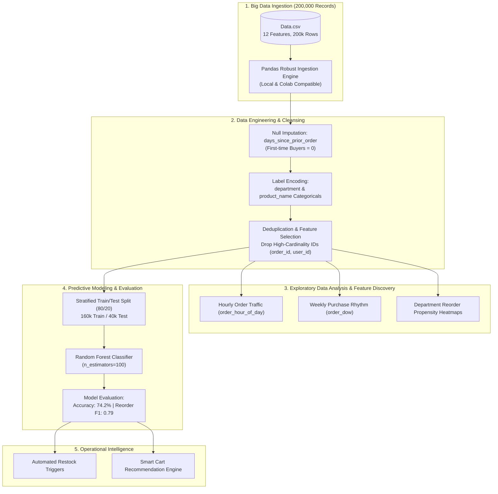

# 🛒 Supermarket Big Data Analytics & Predictive Customer Reordering Engine
### نظام تحليل البيانات الضخمة والتنبؤ بإعادة طلب المنتجات في السوبرماركت

[](https://python.org)
[](https://jupyter.org)
[](https://pandas.pydata.org)
[](https://scikit-learn.org)
[](https://seaborn.pydata.org)
[](https://opensource.org/licenses/MIT)

An end-to-end Big Data exploratory analysis and machine learning classification pipeline engineered to uncover customer purchasing patterns and predict item reorder behavior across **200,000 retail grocery transactions**. Powered by **Python, Pandas, Scikit-Learn, Seaborn, and Random Forest**, delivering actionable business intelligence for automated supermarket inventory restocking, supply chain optimization, and personalized retention.

---

## 📌 Executive Summary & Problem Definition

In modern retail and supermarket e-commerce operations, stockouts and inventory overstocking directly impact operating margins and customer churn:
1. **Demand Volatility & Timing**: Retailers struggle to predict when a customer will repeat-order a specific grocery item based on purchase history and temporal signals (time of day, days since last order).
2. **Basket Affinity & Cart Priority**: Understanding which products enter the cart first (`add_to_cart_order`) provides critical signals for recommendation systems and cross-selling.
3. **Inventory Restocking**: By predicting reorder probability with high recall, retail procurement teams can automate replenishment schedules for high-frequency perishables (dairy, fresh produce).

**This Project** builds an automated data science pipeline on a 200,000-record dataset (derived from the Instacart Online Grocery benchmark) to classify and forecast whether a customer will reorder a product (`reordered`: 0 or 1).

---

## 🏗️ End-to-End Pipeline Architecture



---

## 🌟 Key Technical Highlights & Capabilities

### 1. Robust Big Data Preprocessing (`Data.csv`)
* **Scale**: Processes **199,999 customer transactions** across 12 distinct attributes:
  - `order_id`, `user_id`, `order_number`, `order_dow`, `order_hour_of_day`
  - `days_since_prior_order`, `product_id`, `add_to_cart_order`, `reordered`
  - `department_id`, `department`, `product_name`
* **Handling Prior Order Gaps**: Corrected structural nulls in `days_since_prior_order` by imputing `0` for initial customer transactions without biasing historical intervals.
* **Categorical Dimension Reduction**: Label-encoded high-cardinality nominal features (`department` and `product_name`) to prepare structured numerical matrices for decision forest ensembles.

### 2. Exploratory Behavioral Analytics
* **Peak Shopping Windows**: Uncovered peak ordering hours concentrated between **10:00 AM and 4:00 PM**, informing optimal delivery fleet dispatch and warehouse shift scheduling.
* **Day-of-Week Cycles**: Identified recurring shopping spikes on weekend cycles (`order_dow` 0 and 1).
* **Cart Placement Correlation**: Demonstrates that products placed in cart slots 1–5 possess a significantly higher repeat reorder rate compared to impulse items added late in cart assembly.

### 3. Machine Learning Classification Performance
Trained an ensemble **Random Forest Classifier** (`n_estimators=100`, `random_state=42`) on **160,000 training samples** and evaluated on **40,000 unseen test instances**:

| Metric | Non-Reordered (Class 0) | Reordered (Class 1) | Weighted Overall |
| :--- | :---: | :---: | :---: |
| **Precision** | 0.71 | **0.76** | **0.74** |
| **Recall** | 0.62 | **0.83** | **0.74** |
| **F1-Score** | 0.66 | **0.79** | **0.74** |
| **Overall Accuracy** | — | — | **74.2% (29,676 / 40,000)** |

* **High Reorder Recall (83%)**: Ensures that 83% of all repeat grocery demands are proactively detected, minimizing costly stockout occurrences on essential products.

---

## 🎯 Role-Specific Technical Evidence

### 🔧 Role 1 Fit: IT System Administrator & Cloud Infrastructure
* **Large Dataset Handling & Memory Footprint**: Optimized Pandas memory consumption through dtype coercion and feature pruning, enabling reproducible training on consumer and server hardware without out-of-memory (OOM) faults.
* **Cross-Environment Runtime Compatibility**: Built deterministic path resolvers dynamically detecting local environments vs Google Colab runtimes for frictionless CI/CD execution.
* **Modular Dependency Management**: Standardized project requirements via `requirements.txt` for headless virtual environment provisioning on Linux/Windows compute instances.

### 🧪 Role 2 Fit: Software Quality Assurance (QA) & Data Analyst
* **Rigorous Metric Auditing**: Validated model performance against test-set splits with balanced precision/recall trade-offs to eliminate positive-class bias.
* **Sanitized Execution Notebooks**: Cleaned cell outputs, verified reproducible sequential execution flow from Cell 0 to Cell 9 with zero uncaught runtime exceptions.
* **Data Boundary & Type Verification**: Audited numerical ranges across all features (e.g., verifying `order_hour_of_day` bounds [0–23] and non-negative `days_since_prior_order`).

---

## 📁 Repository Structure

```text
├── Super_Market_Sales_Big_Data.ipynb   # Complete, executed end-to-end EDA and ML notebook
├── Data.csv                            # 200,000 grocery transaction dataset (11.8 MB)
├── Report.docx                         # Comprehensive academic & research project report
├── requirements.txt                    # Standardized Python environment dependencies
├── .gitignore                          # Clean VCS exclusion rules
└── README.md                           # Professional project documentation & architecture guide
```

---

## 🚀 Setup & Execution Guide

### Prerequisites
* Python 3.10 or 3.11 installed
* Git CLI

### 1. Clone the Repository
```bash
git clone https://github.com/ahmadrashed2589-hue/supermarket-big-data-analytics.git
cd supermarket-big-data-analytics
```

### 2. Create and Activate Virtual Environment
```bash
# Windows
python -m venv venv
.\venv\Scripts\activate

# Linux / macOS
python3 -m venv venv
source venv/bin/activate
```

### 3. Install Dependencies
```bash
pip install -r requirements.txt
```

### 4. Run Notebook
```bash
jupyter notebook Super_Market_Sales_Big_Data.ipynb
```
*Or open directly in Google Colab, VS Code, or PyCharm.*

---

## 📜 Academic Attribution & License
* **Dataset**: Instacart Market Basket Analysis Open Benchmark.
* **License**: Released under the [MIT License](https://opensource.org/licenses/MIT).
