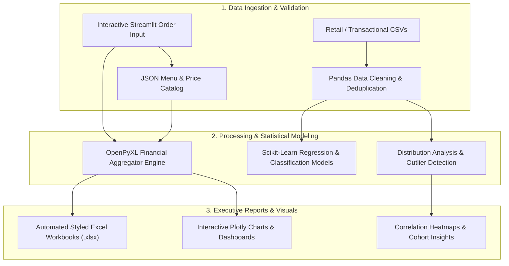

# 📊 Data Intelligence & Machine Learning Benchmarks Suite

[](https://python.org)
[](https://streamlit.io)
[](https://pandas.pydata.org)
[](https://scikit-learn.org)
[](https://plotly.com)
[](https://opensource.org/licenses/MIT)

A focused data engineering, exploratory data analysis (EDA), and machine learning benchmark suite. Highlights automated ETL pipelines, commercial reporting dashboards, and statistical modeling across retail, hospitality, and computer vision domains.

---

## 📌 Suite Contents & Problem Statements

1. **`restaurant-order-intelligence/`**: A commercial operations and order registration dashboard built with Streamlit, Pandas, and OpenPyXL. Generates styled, itemized financial Excel reports per restaurant with real-time revenue KPIs and interactive Plotly visualizations.
2. **`supermarket-big-data-analytics/`**: In-depth exploratory data analysis and customer purchase segmentation on large retail transaction datasets, analyzing gross income distributions, payment channel preferences, and hourly traffic trends.
3. **`computer-vision-benchmarks/`**: Deep convolutional neural network (CNN) architectures evaluated on multi-class retail clothing classification and counterfeit currency detection using OpenCV edge filtering and feature extraction.
4. **`predictive-analytics/`**: Supervised regression pipelines forecasting bike-rental demand using weather metrics, humidity, and temporal regressors.

---

## 🏗️ Architecture & Processing Workflow



---

## 🎯 Role-Specific Technical Evidence

### 🔧 Role 1 Fit: IT System Administrator & Cloud Infrastructure
* **Process Automation & Scripting**: Authored batch launcher scripts (`run_app.bat`, `start_system.bat`) for headless execution and automated virtual environment activation.
* **Lightweight Internal Tool Hosting**: Packaged interactive Streamlit dashboards for operational internal deployment on local or cloud VMs.
* **Storage & File I/O Management**: Implemented programmatic Excel report generation and automated archiving routines preventing memory leaks during repeated workbook exports.

### 🧪 Role 2 Fit: Software Quality Assurance (QA) & Testing
* **Data Integrity & Schema Deduplication**: Tested transaction datasets for null-value handling, outlier detection, and data type coercion ensuring zero silent calculation errors.
* **Financial Logic Verification**: Audited gross margin and tax formula calculations across restaurant invoice exports, ensuring exact cent-level arithmetic reconciliation.
* **Sanitized Execution Notebooks**: Audited and cleaned all analytical Jupyter notebooks, ensuring reproducible execution flow, zero uncaught error traces, and persisted visualization cells.
* **Input Validation & Boundary Testing**: Implemented defensive form validation in the Streamlit application preventing non-numeric price inputs or blank item entries.

---

## 🚀 Setup & Execution Guide

### 1. Restaurant Order Dashboard
```bash
cd restaurant-order-intelligence
pip install -r requirements.txt
streamlit run app.py
```

### 2. Analytical Notebooks
```bash
pip install jupyter pandas numpy scikit-learn matplotlib seaborn plotly
jupyter notebook
# Open and run Super_Market_Sales_Big_Data.ipynb or Deep_Project_F.ipynb
```
